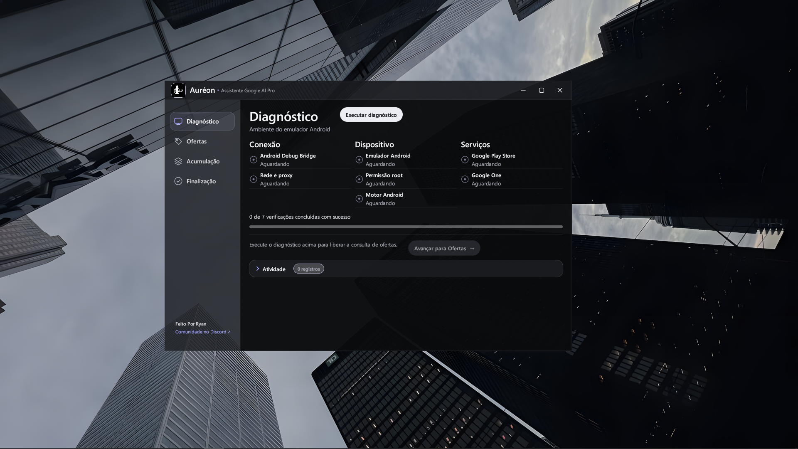
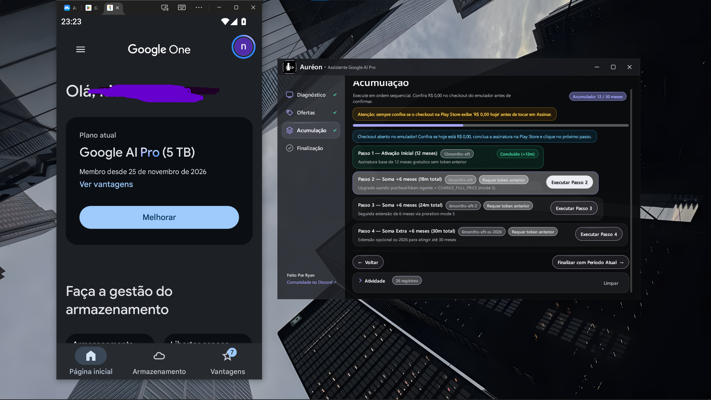

# Auréon

**Auréon** é uma aplicação desktop nativa para Windows escrita em Rust, com interface eframe/egui. O repositório também contém a interface web auxiliar em React, TypeScript e Vite. O fluxo de automação roda no backend Rust, sem depender de Python.

---

## Visão Geral do Produto

Em vez de exigir instalação de Python, bibliotecas externas ou execução manual de vários scripts `.bat` na ordem certa, o **Auréon** executa toda a orquestração diretamente em **Rust nativo** dentro do `src-tauri`:

1. **Diagnóstico Automático do Ambiente:** Localiza ou baixa o `adb.exe`, conecta ao emulador Android (ex.: MuMu Player 12), verifica permissões, prepara os binários Android necessários e confirma se a Google Play Store e o Google One estão instalados e prontos.
2. **Consulta Visual de Elegibilidade:** Lista em cartões visuais quais ofertas gratuitas estão liberadas para a conta logada no emulador (`12 meses`, `+6 meses`, etc.) sem iniciar nenhuma cobrança.
3. **Assistente Passo a Passo (Wizard de Acumulação):** Conduz o usuário etapa por etapa (`12m -> 18m -> 24m -> 30m`), lendo o `purchaseToken` via SQLite nativo em Rust (`rusqlite`), bloqueando etapas fora de ordem, exibindo lembretes claros de conferência de valor zero e detectando automaticamente a confirmação da Play Store.
4. **Checklist Final de Segurança:** Direciona o usuário ao final para desativar a renovação automática, mantendo todo o período acumulado ativo sem risco de cobrança futura.

---

## Capturas de tela

### Diagnóstico do ambiente



### Etapas de acumulação



## Como executar no Windows

### Requisitos

- Windows 10 ou 11, 64 bits.
- Rust stable com o alvo MSVC (`x86_64-pc-windows-msvc`). Instale pelo [rustup](https://rustup.rs/).
- Visual Studio Build Tools com a carga **Desenvolvimento para desktop com C++** e o Windows SDK.

Feche e reabra o terminal depois de instalar o Rust. Confira a toolchain com:

```powershell
rustup toolchain install stable-x86_64-pc-windows-msvc
rustup default stable-x86_64-pc-windows-msvc
rustc --version
cargo --version
```

### Iniciar a aplicação desktop

Na raiz do repositório, execute:

```powershell
cargo run --manifest-path src-tauri/Cargo.toml
```

O primeiro build baixa as crates Rust e pode levar alguns minutos. Para compilar a versão otimizada sem iniciar o app:

```powershell
cargo build --release --manifest-path src-tauri/Cargo.toml
```

O executável de release é gerado em `src-tauri/target/release/aureon.exe`.

### Iniciar a interface web auxiliar

Para rodar a interface React/Vite em desenvolvimento, instale as dependências uma vez e inicie o servidor:

```powershell
npm ci
npm run dev
```

O Vite mostra no terminal o endereço local para abrir no navegador. Esse comando inicia a interface web; para abrir a aplicação desktop, use o comando Cargo acima.

## Como pedir para uma IA executar

Abra o projeto no Codex ou em outra ferramenta de programação com acesso ao terminal e envie:

```text
Na raiz deste projeto, execute a aplicação desktop Auréon com:
cargo run --manifest-path src-tauri/Cargo.toml

Se o build falhar, não altere os arquivos ainda. Mostre o comando executado e o erro completo, identifique a dependência ou ferramenta ausente e me explique o próximo passo.
```

Se quiser apenas a interface web, peça à IA para executar `npm ci` (na primeira vez) e depois `npm run dev`.

## Estrutura do Repositório

```text
aureon/
├── README.md
├── docs/
│   ├── ARCHITECTURE.md
│   ├── REFERENCE.md
│   └── images/                # Capturas de tela exibidas acima
├── src/                       # Interface React/Vite auxiliar
├── src-tauri/                 # Aplicação desktop e backend Rust
└── reference/legacy-cli/      # Scripts antigos mantidos como referência
```

---

## Documentação

- [Arquitetura 100% Rust + Tauri v2](docs/ARCHITECTURE.md)
- [Referência do Sistema Legado](docs/REFERENCE.md)
---

